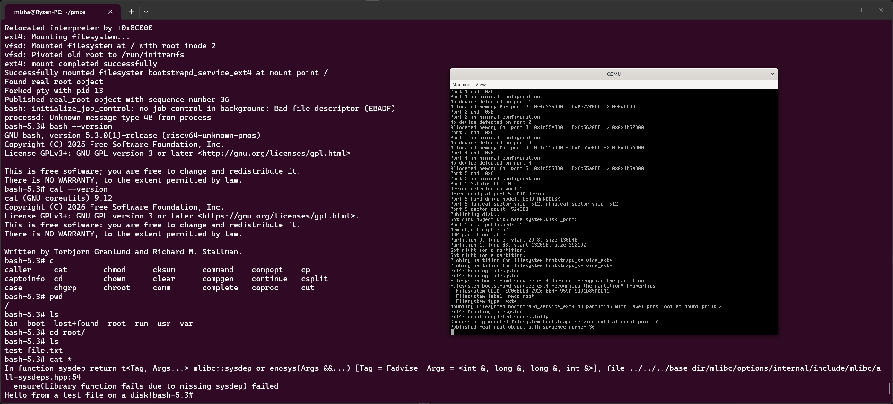
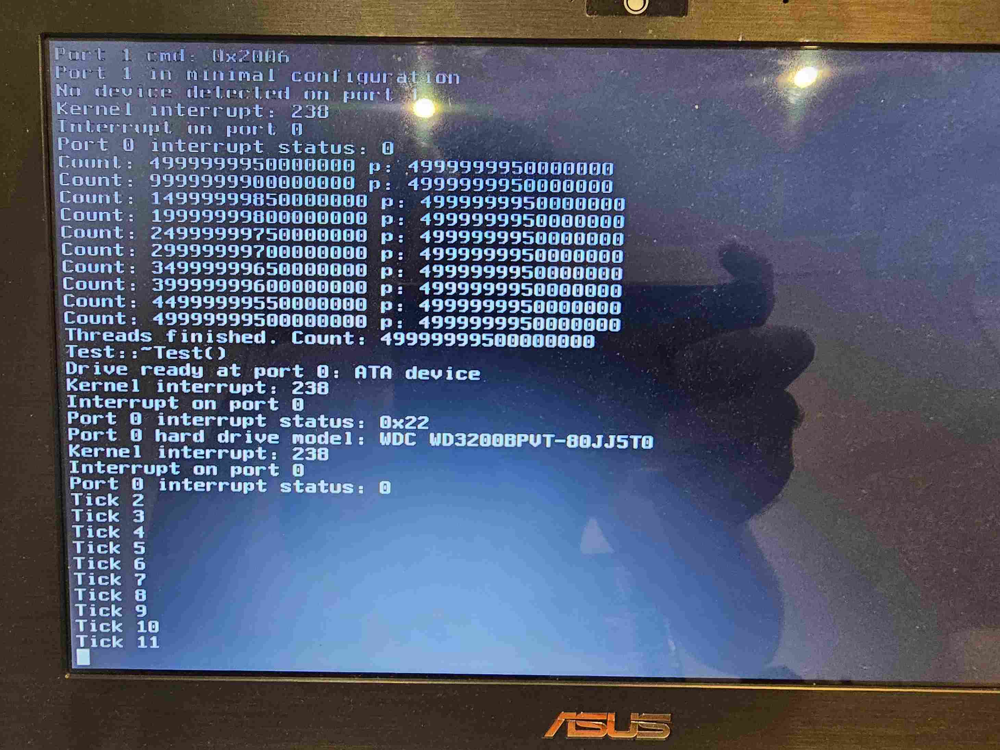

# pmOS

A small (hobby) multiserver microkernel operating system for RISC-V, AArch64, LoongArch and x86 (i686 and x86_64), using a homemade kernel and userspace, and [mlibc](https://github.com/managarm/mlibc) as the main C library, partially developed as my end of degree project. The goal of the project is to make a general purpose operating system, with the objective of learning and being suitable for development and exploration of the RISC-V and X86 platforms. The microkernel is mostly written in C++, and the userspace is in a mixture of C, C++ and Rust (and ASM where needed). The kernel is bootable with [limine bootloader](https://limine-bootloader.org/), [Hyper bootloader](https://github.com/UltraOS/Hyper) and multiboot2 on their supported architectures.

The kernel supports multithreading and preemptive multitasking with SMP (on all supported architectures), asynchronous message passing with capabilities, and virtual memory with lazy allocation and copy-on-write. Userspace drivers and servers support basic system initialization and device discovery (with ACPI and very basic DTs support). With that, the OS can currently run programs such as Bash and coreutils over uart (ns16550 and pl011), loaded from an ext4 partition on an AHCI or NVMe disk, and has been tested bare metal on numerous x86 PCs and also some AArch64 SBCs.

## Screenshots
RISC-V Execution, running bash in qemu-riscv64 with ns16550 terminal:


Bare metal execution (of an old build) on an old x86 (AMD E450) laptop, discovering an internal SATA HDD:


## Architecture

The OS is trying to follow a multiserver microkernel architecture, running most drivers and servers in userspace. The kernel is in charge of memory management, scheduling, interrupts, and IPC. Capabilities are used for natural permissions management. The POSIX functions are mostly handled by personality servers in userspace, communicating through IPC.

Asynchronous IPC queues are currently used for IPC, with unbounded async send (multi-sender, anyone holding the right to send), and sync receive of messages of arbitrary size (with a single thread receiver). In addition, the kernel exposes memory objects to userspace, which can be used to provide shared memory between processes, and futex for quicker synchronization. The capabilities (rights) can either be transferred over IPC, or be moved between the capability namespaces (kernel process groups).

The system bringup works by first starting the kernel with some boot protocol (limine, multiboot2 or Hyper), which then starts the statically linked bootstrap server, which in turn starts the posix/processd server, which then bringup the rest of the userspace.

## Project structure

The project is roughly structured as follows:
- `kernel/` - The microkernel
- `lib/` - Different system libraries
- `mlibc/` - The [mlibc](https://github.com/managarm/mlibc) C library
- `userspace/` - Different userspace servers/programs
- `host-recipes/`, `recipes/`, `chariot.lua`, `chariot_config.toml` - [Chariot](https://chariot-build.dev/) tools, packages, patches and build configuration
- `scripts/` - Build support scripts

## Compilation and execution

The system is built with [Chariot](https://chariot-build.dev/). A Linux x86-64
host with user namespaces, overlayfs, curl, sha256sum, Git, Make and QEMU is
required.

```sh
git submodule update --init --recursive
make qemu                 # RISC-V64, Limine
make qemu-aarch64         # AArch64, Hyper
make qemu-x86             # amd64, Hyper
make qemu-i686            # ia32, Hyper
make qemu-loongarch64     # LoongArch64, Limine
```

To build without running QEMU, use an image target such as
`make build-x86_64/pmos.img`. Clang is the default; pass `TOOLCHAIN=gcc` to use
GCC.

For an amd64 kernel with ia32 userspace, use `make qemu-x86-compat`
(Hyper) or `make qemu-x86-compat-limine`. Build-only images live in
`build-x86_64-i686/`.

For individual packages, run Chariot from the repository root:

```sh
./scripts/install-chariot.sh
.chariot-tools/bin/chariot build --arch riscv64 bash
.chariot-tools/bin/chariot build --arch m68k -o toolchain=gcc mlibc
```

Pass extra options through `CHARIOT_FLAGS`, for example `'-j 8'` or
`--allow-new-profiles` for unattended builds. Personal source overrides and
build-directory caching belong in `.chariot.toml`; see the
[Chariot configuration reference](https://chariot-build.dev/configuration/).

## Plans

1. Get better read-write filesystem drivers (UDF, ext4, FAT32, etc.)
2. Implement working set for virtual memory (swap and page replacement)
3. Implement whatever is needed to port programs

## Dependencies

The following libraries have been used in the project, possibly containing their own licenses:
- [smoldtb](/kernel/smoldtb/)
- [flanterm](/terminald/flanterm/)
- dlmalloc in kernel
- [uACPI](/devicesd/generic/uACPI/)

## License

Unless otherwise stated (see the dependencies), the project is licensed under the BSD 3-Clause license. See the [LICENSE](LICENSE) file for more information.
