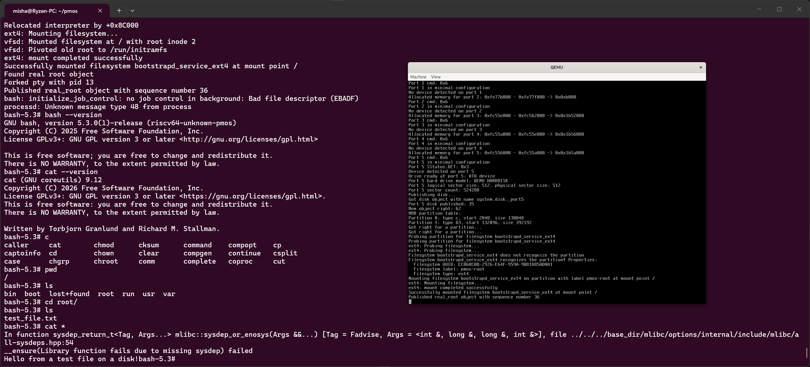
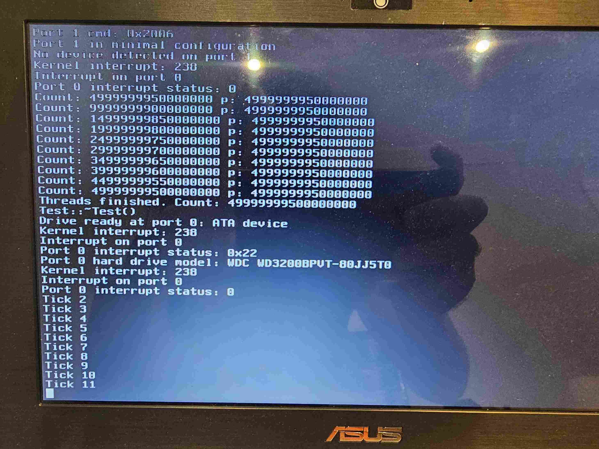

# pmOS

A small (hobby) multiserver microkernel operating system for RISC-V, LoongArch and x86 (i686 and x86_64), using a homemade kernel and userspace, and [mlibc](https://github.com/managarm/mlibc) as the main C library, partially developed as my end of degree project. The goal of the project is to make a general purpose operating system, with the objective of learning and being suitable for development and exploration of the RISC-V and X86 platforms. The microkernel is mostly written in C++, and the userspace is in a mixture of C, C++ and Rust (and ASM where needed). The [limine bootloader](https://limine-bootloader.org/) and [Hyper bootloader](https://github.com/UltraOS/Hyper) are used for booting the system, depending on the architecture, and i686 and x86_64 ports are also bootable with multiboot2, with x86_64 version being triple protocol with the same binary.

## Screenshots
RISC-V Execution, running bash in qemu-riscv64 with ns16550 terminal:


Baremetal execution (of an old build) on an old x86 (AMD E450) laptop, discovering an internal SATA HDD:


## Architecture

The OS is trying to follow a multiserver microkernel architecture, running most drivers and servers in userspace. The kernel is in charge of memory management, scheduling, interrupts, and IPC. Capabilities are used for natural permissions management. The POSIX functions are mostly handled by personality servers in userspace, communicating through IPC.

Asynchronous IPC queues are currently used for IPC, with unbounded async send (multi-sender, anyone holding the right to send), and sync receive of messages of arbitrary size (with a single thread receiver). In addition, the kernel exposes memory objects to userspace, which can be used to provide shared memory between processes, and futex for quicker synchronization. The capabilities (rights) can either be transferred over IPC, or be moved between the capability namespaces (kernel process groups).

The system bringup works by first starting the kernel with some boot protocol (limine, multiboot2 or Hyper), which then starts the statically linked bootstrap server, which in turn starts the posix/processd server, which then bringup the rest of the userspace.

## Project structure

The project is roughly structured as follows:
- `kernel/` - The microkernel
- `lib/` - Different system libraries
- `mlibc/` - The [mlibc](https://github.com/managarm/mlibc) C library
- `userspace/` - Different userspace servers/programs
- `host-recipes/`, `recipes/`, `patches/`, `Jinxfile` - [Jinx](https://codeberg.org/Mintsuki/jinx) build system stuff
- `scripts/` - Build support scripts

## Compilation and execution

The [Jinx meta-build-system](https://github.com/Mintsuki/Jinx) is used for building the system. A Makefile is provided in the root of this project, which downloads Jinx and uses it to build the system images for different architectures. The `qemu`, `qemu-x86`, `qemu-i686` and `qemu-loongarch64` makefile targets are provided to build and run RISC-V, amd64, ia32 and LoongArch64 images in qemu, respectively.

If you would like to use jinx directly, you can run
```sh
export source_dir=<path to this repository>

cd ${source_dir} && git submodule update --init --recursive # Prepare submodules
make -C ${source_dir} jinx # Download jinx

cd <your build directory>
${source_dir}/jinx init ${source_dir} ARCH=<desired architecture, e.g. riscv64, x86_64, i686, loongarch64>
${source_dir}/jinx build limine-disk-image
```

## Plans

1. Get better read-write filesystem drivers (UDF, ext4, FAT32, etc.)
2. Implement working set for virtual memory (swap and page replacement)
3. Implement whatever is needed to port programs

## Features

These are the features that are planned to be had in the OS:

### Kernel

#### Arch-independent features:
- [x] Processes and threads
  - [x] Processes
  - [x] Task switching
  - [x] Preemptive multitasking (boring)
  - [X] Threads - basic pthread implementation in userspace building on kernel interfaces
  - [X] Kernel threads
  - [x] User space

- [ ] Memory
  - [x] Page frame allocator
    - [x] Zone allocator - currently only splits memory into <4GB and >=4GB zones (for legacy devices)
  - [x] Kernel virtual memory manager
  - [x] kmalloc
  - [x] Allocating memory to userspace
  - [x] Userspace memory regions
    - [x] Mapping (anonymous mmap)
    - [x] Lazy allocations
    - [x] Full unmapping
    - [x] Partial and overlapping unmapping (munmap)
    - [ ] memprotect and changing permissions
    - [x] Access to physical memory
    - [x] Mapping of memory objects
    - [x] Copy-on-write
  - [ ] Memory objects
    - [x] Memory object creation from kernel
    - [x] Memory object access from kernel
    - [ ] Blocking tasks on memory object access in kernel/pagers
    - [x] Memory object mapping to userspace
    - [x] Memory object creation and management from userspace
  - [x] Delayed allocation
  - [x] Memory protections
  - [x] TLB shootdowns
  - [ ] Swapping
  - [x] SMP


- [x] Interrupts
  - [x] Interrupt dispatching to userspace drivers
  - [x] Interrupt sharing
  - [ ] Proper interrupt priorities

- [x] IPC and messaging
  - [x] Buffered string messages
  - [x] Ports
  - [x] Kernel messages
  - [x] Quick user memory access - catching exceptions on userspace memory access
  - [x] Rights (handles/capabilities)
    - [x] Send once/many rights
    - [x] Memory objects rights
    - [x] Interrupt rights
    - [x] Timer rights
    - [ ] Phys memory/iommu rights
    - [ ] I/O ports rights
    - [x] Notification of closed rights
    - [x] Sending rights over IPC
  
- [x] ~~Permissions~~ -> capabilities
- [x] Multi CPU support

#### RISC-V specific features:
- [x] 3 to 5 level page tables

#### x86-specific features:
- [x] Time
  - [x] ACPI PM Timer (clock source and calibration)
  - [x] HPET (clock source and calibration)
  - [x] LAPIC timer
  - [x] TSC
  - [x] TSC deadline
  - [ ] KVM clock
- [ ] APIC
  - [x] xAPIC
  - [x] x2APIC
  - [x] LAPIC
  - [ ] IOMMU

#### x86_64-specific features:
- [x] 5 level paging
- [x] FRED

#### i686-specific features:

- [x] Virtual memory
  - [x] 2 level page tables
  - [x] PAE - supports and uses up to 16GB of RAM, if available


**Core utilities and daemons**
- [ ] Process management (processd) - Mostly unfinished, I plan it to route signals
- [ ] Networking (networkd)
- [ ] Filesystems
  - [x] ext4 - With the help of [ext4plus crate](https://crates.io/crates/ext4plus/) in userspace
    - [x] Partition probing
    - [x] Mounting
    - [x] Reading
    - [ ] Writing - not supported by the driver
  - [ ] UDF
  - [ ] FAT32
  - [ ] FUSE
  - [ ] USTAR filesystem daemon - Archive parsing works, but it is very incomplete
- [ ] Drawing on screen (screend)
  - [x] Framebuffer
    - [x] Showing text with framebuffer
- [ ] Human input
- [X] Native executables
- [ ] POSIX compatibility layer - Many functions are implemented and working, but a lot more are yet to be done

**Drivers**
- [X] PS/2
  - [X] Keyboard - works, but needs something to funnel the input to
  - [ ] Mouse
- [X] i8042
- [ ] ATA/Bulk storage
  - [ ] AHCI
    - [X] Controller detection and initialization
    - [X] Device detection
    - [X] DMA
    - [X] interrupts handling
    - [X] Reading
    - [ ] Writing - no filesystems yet
  - [ ] NVMe
  - [ ] Virtio block
- [ ] USB
- [X] Serial/Parallel - ns16550 using interrupts for receiving and sending. Works on RISC-V, missing IO ports stuff and untested on x86.
- [X] PCI/PCIe
  - [x] Device detection
  - [x] Legacy interrupt routing - Works on x86, broken on RISC-V, likely easy to fix
  - [ ] MSI/MSI-X
- [ ] Network cards
- [ ] virtio
  - [ ] virtio-user-input
- [X] ACPI (using uACPI)
  - [X] Initialization
  - [X] IRQ routing
  - [X] Power button (interrupt) and shutting down
  - [X] EC driver
  - [X] AMD GPIO driver
  - [ ] S3 sleep - kinda works, but doesn't have a proper interface for drivers


**Userland**
- [ ] Screen/keyboard tty
- [x] ns16550 serial console
- [ ] GUI
- [x] C/POSIX Library - using mlibc
- [ ] Init server
  - [x] Launching servers
  - [x] Matching pmbus objects

**Languages/Runtimes**
- [X] LLVM/Clang patch
- [X] Hosted GCC cross-compiler
- [X] C and its runtime (using homemade C/POSIX library)
- [X] C++ and libstdc++ (and other) runtime(s) - Compiling and working but a lot of C library functions are missing
- [X] Go and libgo runtime with GCC - Compiling, but untested and probably broken for now. Also, exec-stuff is missing

## Dependencies

The following libraries have been used in the project, possibly containing their own licenses:
- [smoldtb](/kernel/smoldtb/)
- [flanterm](/terminald/flanterm/)
- dlmalloc in kernel
- [uACPI](/devicesd/generic/uACPI/)

## License

Unless otherwise stated (see the dependencies), the project is licensed under the BSD 3-Clause license. See the [LICENSE](LICENSE) file for more information.